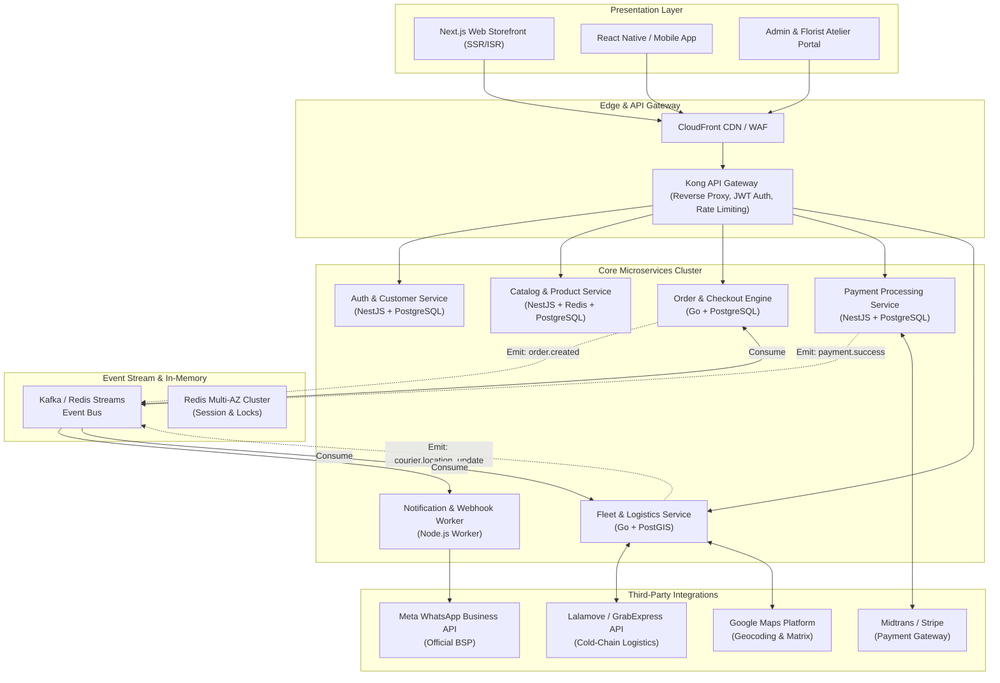
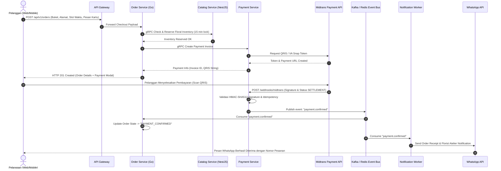
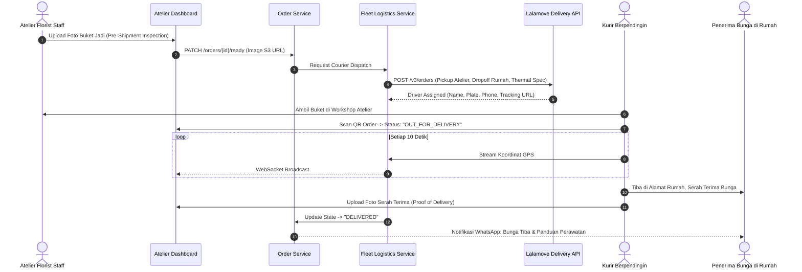

# Arsitektur Sistem & Spesifikasi Integrasi (System Architecture)
## Platform E-Commerce Bunga Premium (Premium Flower E-Commerce Platform)

**Document Version:** 1.0.0  
**Scope:** Microservices Blueprint, Data Flow, Event-Driven Topology & 3rd-Party Integrations  
**Doc ID:** ARCH-FLORA-2026-001  

---

## 1. Ikhtisar Arsitektur Microservices

Platform E-Commerce Bunga Premium menggunakan pola arsitektur **Microservices Event-Driven** yang memisahkan tanggung jawab bisnis (*separation of concerns*). Setiap domain layanan memiliki database sendiri (*Database-per-Service*) atau schema terisolasi untuk memastikan otonomi dan skalabilitas independen.

---

## 2. Rincian Layanan Mikro (Microservices Breakdown)

### 2.1 Auth & Customer Service
- **Tanggung Jawab:** Manajemen identitas pelanggan, autentikasi berbasis JWT (Access Token 15 menit + Refresh Token terenkripsi dalam HTTP-only cookie), profil VIP, data alamat buku pengiriman (*address book*), dan riwayat penerima bunga.
- **Port Komunikasi:** HTTP/REST 3001, Internal gRPC 50051.
- **Data Store:** PostgreSQL `flora_auth_db`.

### 2.2 Catalog & Product Service
- **Tanggung Jawab:** Manajemen katalog 20+ varian bunga, harga dinamis, formula ukuran buket (*Petite, Deluxe, Grand, Royale*), inventaris bunga segar (*fresh-cut inventory count*), dan metadata kartu ucapan.
- **Caching Strategy:** Cache warming di Redis untuk query katalog terlaris dengan invalidasi otomatis via webhook saat admin florist mengupdate stok.
- **Port Komunikasi:** HTTP/REST 3002, Internal gRPC 50052.
- **Data Store:** PostgreSQL `flora_catalog_db` + Redis L1.

### 2.3 Order & Checkout Engine (High-Performance Core in Go)
- **Tanggung Jawab:** Pengelolaan siklus hidup pesanan (*Order Lifecycle State Machine*), alokasi reservasi bunga potong dengan waktu tunggu pembayaran 15 menit, kalkulasi subtotal, diskon voucher, dan koordinasi pengiriman terjadwal.
- **Status Lifecycle Pesanan:**
  `PENDING_PAYMENT` $\rightarrow$ `PAYMENT_CONFIRMED` $\rightarrow$ `FLORIST_ARRANGING` $\rightarrow$ `QUALITY_CHECK_APPROVED` $\rightarrow$ `OUT_FOR_DELIVERY` $\rightarrow$ `DELIVERED` / `CANCELLED`.
- **Port Komunikasi:** HTTP/REST 3003, Internal gRPC 50053.
- **Data Store:** PostgreSQL `flora_order_db`.

### 2.4 Payment Processing Service
- **Tanggung Jawab:** Integrasi ke Payment Gateway (Midtrans/Stripe), pembuatan snap invoice, verifikasi webhook signature HMAC-SHA512, penanganan idempotensi transaksi untuk mencegah double charge, dan pencatatan audit log pembayaran.
- **Port Komunikasi:** HTTP/REST 3004, Internal gRPC 50054.
- **Data Store:** PostgreSQL `flora_payment_db`.

### 2.5 Fleet & Logistics Service
- **Tanggung Jawab:** Validasi alamat via Google Maps Geocoding API, kalkulasi jarak pengiriman, pemilihan armada berpendingin (mobil ber-AC untuk bunga besar vs motor dengan thermo-box untuk buket sedang), interaksi API Lalamove/GrabExpress untuk dispatch kurir otomatis, dan streaming koordinat GPS kurir via WebSocket.
- **Port Komunikasi:** HTTP/REST 3005, WebSocket 3006, gRPC 50055.
- **Data Store:** PostgreSQL `flora_logistics_db` (dengan ekstensi `PostGIS`).

### 2.6 Notification & Webhook Worker
- **Tanggung Jawab:** Mengonsumsi event dari Message Bus dan mengirimkan notifikasi multi-kanal:
  1. WhatsApp Business Template (Notifikasi konfirmasi, link pelacakan, dan foto preview bunga).
  2. Email Transaksional (Invoice PDF resmi untuk B2B).
  3. Web Push Notification untuk update status pesanan.

---

## 3. Diagram Alur Data & Transaksi (Sequence Diagrams)

### 3.1 Alur Transaksi Pemesanan hingga Pembayaran Berhasil

### 3.2 Alur Pemenuhan & Pelacakan Kurir Real-Time

---

## 4. Rincian Integrasi Pihak Ketiga (Third-Party Integrations)

### 4.1 Payment Gateway: Midtrans & Stripe
- **Protokol:** HTTPS REST API dengan payload bertanda tangan (*HMAC-SHA512 Signature Verification*).
- **Metode Pembayaran:**
  - QRIS Dinamis (Real-Time Settlement).
  - Virtual Account Bank (BCA, Mandiri, BNI, BRI, Permata).
  - Kartu Kredit / Debit Online (3D Secure dengan tokenisasi fraud detection).
  - e-Wallet (GoPay, ShopeePay).
- **Penanganan Gagal & Timeout:**
  - Mekanisme rekonsiliasi berkala (*cron reconciler job*) setiap 10 menit untuk memeriksa status pesanan menggantung melalui API `GET /v2/{order_id}/status`.

### 4.2 Layanan Logistik & Kurir: Lalamove & GrabExpress API
- **Spesifikasi Kendaraan:**
  - Pengiriman rangkaian bunga meja besar dan standing flowers wajib menggunakan armada mobil MPV ber-AC untuk mencegah kerusakan terpaan angin dan panas jalanan.
  - Pengiriman buket tangan standar menggunakan motor bertas khusus pendingin (*insulated thermal delivery box*).
- **Fitur API yang Digunakan:**
  - *Quotation API*: Menghitung ongkir presisi berdasarkan jarak kilometer riil dan opsi thermal box.
  - *Order Dispatch API*: Otomasi pemesanan armada tanpa intervensi manual staf toko.
  - *Live Tracking Webhook*: Menerima event kurir (tiba di toko, pick-up, mendekati alamat tujuan, selesai antar).

### 4.3 Notifikasi: Meta WhatsApp Business Cloud API
- **Penyedia Layanan:** WhatsApp Business Platform (Cloud API resmi).
- **Template Pesan Terdaftar (Approved HSM):**
  1. `order_confirmation_v1`: Notifikasi rincian pesanan, total biaya, dan perkiraan waktu perangkaian.
  2. `pre_shipment_photo_v1`: Pengiriman foto hasil rangkaian buket segar sebelum kurir berangkat, lengkap dengan tombol interaktif untuk persetujuan.
  3. `live_tracking_link_v1`: Tautan aman ke dashboard pelacakan kurir real-time.
  4. `delivery_success_v1`: Foto bukti penerimaan di depan rumah dan panduan merawat bunga agar tahan 7-10 hari.

### 4.4 Geocoding & Radius: Google Maps Platform
- **Distance Matrix API:** Menghitung estimasi waktu tempuh (*ETA*) dengan memperhitungkan kondisi kemacetan kota metropolitan secara langsung.
- **Places Autocomplete & Geocoding API:** Memastikan kelengkapan nama jalan, blok, dan koordinat lintang-bujur (*latitude-longitude*) untuk menghindari kurir tersesat.

---

## 5. Keamanan Sistem, Idempotensi & Resilience Patterns

1. **Idempotency Keys:** Setiap request checkout dan proses pembayaran menyertakan header `X-Idempotency-Key: UUIDv4` yang disimpan di Redis dengan TTL 24 jam untuk mencegah duplikasi order akibat double-tap pelanggan.
2. **Circuit Breaker (Resilience4j / Go Hystrix):** Mengamankan koneksi keluar ke payment gateway dan kurir. Jika API pihak ketiga mengalami downtime, fallback response dikembalikan tanpa mematikan layanan aplikasi utama.
3. **Data Protection & Encryption:**
   - Transport Layer Security (TLS 1.3) untuk seluruh komunikasi HTTP.
   - Database field-level encryption untuk data pribadi sensitif (nomor telepon penerima, pesan kartu ucapan rahasia).
